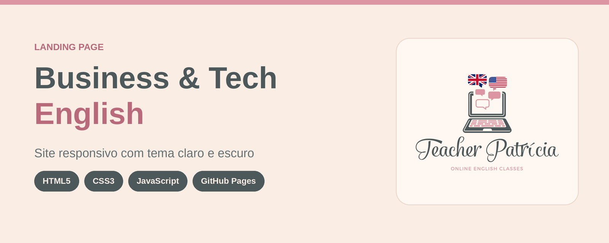

<p align="center">
  
</p>

# Teacher Patrícia · Landing Page

<p>
  <a href="https://www.teacherpatricia.net/"><b>🔗 Ver o site no ar</b></a>
</p>

Landing page da **Teacher Patrícia**, professora de inglês online focada em **Business English** e **Tech English**. Site estático (HTML, CSS e JavaScript puros), sem build e sem dependências.

## Páginas

| Arquivo | Descrição |
| --- | --- |
| `index.html` | Landing page principal: hero, trilhas (Business/Tech), como funciona, para quem é, loja e CTA final. |
| `loja.html` | Página "Loja em construção", enquanto a loja real não está no ar. |
| `flexge.html` | Página "Flexge: o material didático" (plataforma, telas do app, sala de aula invertida, certificados), aberta em nova aba pelo selo "Saiba mais" do hero. |
| `empresa.html` | Página "Business English para empresas" (programa 2027, trilha Tech English, depoimentos e contato), aberta em nova aba pelo seletor do hero. |
| `404.html` | Página de erro. Tem **CSS e JS embutidos** para funcionar em qualquer rota. |

## Estrutura do projeto

```
teacher-patricia/
├── index.html
├── loja.html
├── flexge.html
├── empresa.html
├── 404.html
├── README.md
├── css/
│   └── style.css
├── js/
│   └── main.js
├── img/
│   ├── selo-parceiro-flexge.png
│   ├── social-preview.png     ← imagem de compartilhamento (1200×630)
│   ├── readme-cover.png       ← capa deste README (1600×640)
│   ├── favicon.svg            ← ícone da aba (navegadores modernos)
│   ├── favicon.ico            ← ícone da aba (fallback)
│   ├── apple-touch-icon.png   ← ícone ao salvar na tela inicial do iPhone
│   └── flexge/                ← imagens da página Flexge (cedidas pela Flexge)
```

## Identidade visual

**Paleta**

| Cor | Hex | Uso |
| --- | --- | --- |
| Ardósia | `#4D585A` | Títulos, notebook, botões secundários |
| Rosa | `#DB95A3` | Destaques, botões principais, bolhas do chat |
| Creme | `#FAEDE4` | Fundo do tema claro |

**Tipografia**

- **Montserrat**: textos.
- **Satisfy**: logo e destaques em script.

As duas vêm do Google Fonts (licença livre) e são carregadas no `<head>` de cada página. As cores e fontes ficam como variáveis no topo do `css/style.css` (`:root`).

> O manual de marca usa Salamander Script e Simplicity, que são fontes comerciais. A Satisfy foi escolhida como alternativa gratuita e parecida. Para usar as originais, é necessário ter licença de web font e adicionar os arquivos ao projeto.

## Tema claro e escuro

- Segue automaticamente a preferência do sistema (`prefers-color-scheme`).
- O botão 🌙/☀️ no menu alterna manualmente e salva a escolha no `localStorage`.
- Todas as cores vêm de variáveis CSS. Para ajustar um tema, edite os blocos de tokens no `:root` do `style.css`.

## O que você precisa trocar antes de publicar

**Já configurados**

- Instagram: `https://instagram.com/teacherpatricia.insta` (`index.html` e `loja.html`)
- LinkedIn: `https://www.linkedin.com/in/teacherpatricianet/` (`index.html` e `loja.html`)
- WhatsApp: `https://wa.me/5551989406926` (`index.html`, `loja.html` e `404.html`)


## Parceria

O selo **Parceiro Flexge** aparece no hero, acima do notebook (`img/selo-parceiro-flexge.png`).

